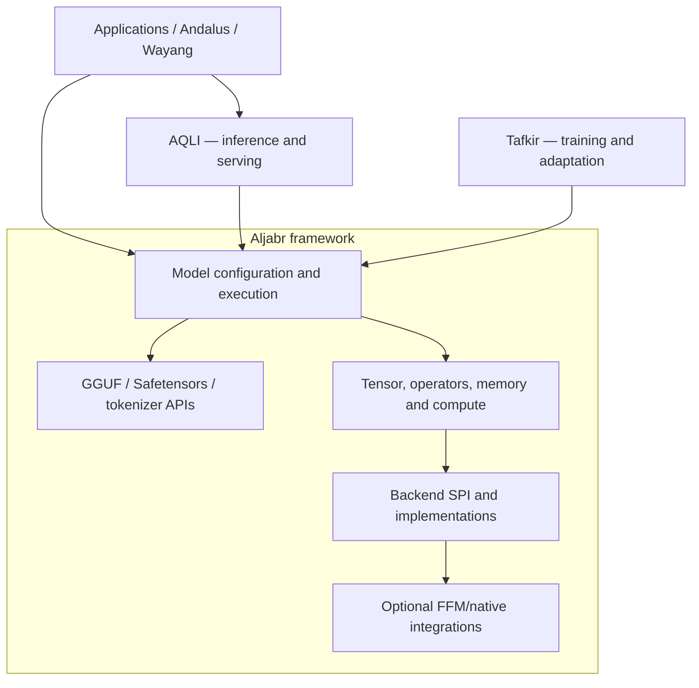

# Aljabr — Java Machine-Learning Framework

[](https://github.com/andalus-ai/aljabr/actions/workflows/ci.yml)
[](https://openjdk.org/projects/jdk/25/)
[](LICENSE.md)
[](https://github.com/andalus-ai/aljabr/packages)

Aljabr is a Java-first machine-learning engine and framework for research, development, education and application building. It provides reusable tensor and compute APIs, model abstractions, weight/format integrations, and hardware-backend interfaces.

If you are familiar with the Python ecosystem, Aljabr is **inspired by the framework role of PyTorch and the model/configuration ecosystem of Hugging Face Transformers**. It is not a drop-in replacement for their APIs, and the capabilities of each model, backend and module must be checked individually.

## Where Aljabr fits

- **Aljabr — engine/framework:** tensors, operators, memory, reusable model execution, autograd and optimizer primitives, format/tokenizer contracts and compute backends. Training primitives must be enabled and validated as described in the research-readiness audit.
- **[AQLI](https://github.com/andalus-ai/aqli) — inference runtime:** request handling, generation policy, scheduling, streaming, serving APIs, deployment and runtime lifecycle.
- **[Tafkir](https://github.com/andalus-ai/tafkir) — training/adaptation workflows:** dataset pipelines, higher-level training orchestration, fine-tuning and adaptation built on Aljabr's reusable computation and optimization primitives.
- **[Andalus](https://github.com/andalus-ai/andalus) / [Wayang](https://github.com/bhangun/wayang) — application layer:** agent, tool, RAG and enterprise workflow orchestration.

Aljabr must not depend on AQLI. Tafkir integration is optional and must not be required for foundational Aljabr development or ordinary AQLI inference.

## Contents

- [Design goals](#design-goals)
- [Architecture](#architecture)
- [Requirements](#requirements)
- [Build from source](#build-from-source)
- [Using Aljabr from a Java project](#using-aljabr-from-a-java-project)
- [Formats and backends](#formats-and-backends)
- [Repository layout](#repository-layout)
- [Documentation](#documentation)
- [Contributing and validation](#contributing-and-validation)
- [License](#license)

## Design goals

- **Java-first APIs:** JDK 25 is the documented baseline.
- **Modular framework:** tensor, operator, model, format and backend capabilities are split into modules.
- **Explicit capabilities:** model/backend compatibility should be discoverable and fail with actionable errors when unsupported.
- **Resource safety:** memory, mapped files, native handles and device allocations need explicit ownership and lifecycle rules.
- **Native interoperability:** prefer Java's Foreign Function & Memory (FFM) API for new native integration; do not add JNI dependencies without an explicit architectural decision.
- **Optional integrations:** native runtimes, accelerator backends, quantization integrations and training-related modules must not make unrelated core capabilities unusable.
- **Reproducible engineering:** focused tests, clean dependency boundaries, published-artifact checks and performance evidence for optimizations.

## Architecture



### Responsibility boundaries

| Area | Responsibility |
|---|---|
| Tensor and compute | Shapes, dtypes, storage, operators, kernels and backend dispatch |
| Model framework | Reusable model configuration, topology and execution contracts |
| Model formats | Parsing, metadata/weight loading and validation for supported formats |
| Native integration | FFM declarations, ABI/layout handling and native resource lifecycle |
| Inference runtime | AQLI owns request scheduling, sampling/stopping policy, streaming and service operations |
| Training | Aljabr provides reusable autograd/optimizer primitives where implemented and validated; Tafkir owns workflow orchestration, dataset pipelines and adaptation policy |

The architecture is being consolidated across repositories. Existing code is migrated only after behavior, API compatibility, resource lifecycle and tests establish parity. A loader existing in Aljabr does not automatically mean a full AQLI execution path can be removed.

See the [Framework Architecture](docs/architecture/FRAMEWORK_ARCHITECTURE.md) for detailed sequences, module rules and validation criteria.

## Requirements

- JDK 25.
- Git.
- The Gradle Wrapper included in the repository.
- Additional platform toolchains and native libraries only for the specific optional backend being built.

CPU/core development should remain possible without a local accelerator. Metal, CUDA, ROCm and other hardware-specific paths require platform-appropriate build and runtime validation.

## Build from source

```bash
git clone https://github.com/andalus-ai/aljabr.git
cd aljabr
./gradlew projects
```

Run the relevant tests for your change. For a broad baseline, the repository provides the Gradle test task:

```bash
./gradlew test
```

A multi-module repository can include platform-specific or optional modules with additional prerequisites. If a broad build fails, use `./gradlew projects` to identify the exact module and run its focused compile/test tasks; do not assume an optional native backend is required for every core change.

### Optional Tafkir integration

The foundational Aljabr build must not require a sibling Tafkir checkout. Where the repository exposes a Tafkir integration profile, use it only when intentionally validating that cross-project integration. The profile and its required sibling checkout are described in the Gradle settings/build configuration; a profile name alone does not guarantee that the external project currently builds.

## Using Aljabr from a Java project

Aljabr modules are published as Maven artifacts through GitHub Packages when a release publishes them. Configure credentials in your user-level Gradle properties; never commit a token:

```properties
gpr.user=YOUR_GITHUB_USERNAME
gpr.key=YOUR_GITHUB_TOKEN
```

Example repository configuration:

```kotlin
repositories {
    maven {
        url = uri("https://maven.pkg.github.com/andalus-ai/aljabr")
        credentials {
            username = providers.gradleProperty("gpr.user").orNull
            password = providers.gradleProperty("gpr.key").orNull
        }
    }
}
```

The group is `tech.kayys.aljabr`; artifact IDs and versions are module- and release-specific. Check the [published packages](https://github.com/andalus-ai/aljabr/packages) and the selected module's build metadata before copying a dependency declaration. For private packages, authentication and visibility follow GitHub's package settings.

## Formats and backends

The repository contains modules for several formats and backend integrations. **Availability is module-, model-, platform- and version-specific.** A parser or loader does not imply that every model can execute, and a backend module does not imply complete operator coverage.

- **GGUF:** reusable format and weight support; native llama.cpp/ggml paths require the matching native library and ABI.
- **Safetensors:** header/metadata and tensor-weight loading, with execution capabilities depending on the selected model and backend.
- **ONNX and LiteRT:** integration depends on the selected runtime, supported operators and model compatibility.
- **CPU / Metal / CUDA / ROCm:** use only on supported platforms and validate the corresponding backend tests.
- **Quantization:** support depends on the format, quantizer, kernel and integration. Do not infer production support from a type or CLI option alone.

The intended direction is Java/FFM-first where feasible. LibTorch may exist as an optional compatibility/fallback path during migration; it should not become a mandatory dependency of the future Java Safetensors runner.

## Repository layout

```text
core/       Tensor, model, format, tokenizer, memory and shared framework modules
backend/    Compute backend implementations and hardware-specific kernels
models/     Model-family implementations and shared model components
docs/       Architecture, design and developer documentation
scripts/    Development, benchmark and build tooling
```

Use `./gradlew projects` as the source of truth for the exact current Gradle module names and nesting.

## Documentation

- [Research and Training Readiness](docs/architecture/RESEARCH_TRAINING_READINESS.md) — audit of autograd build visibility, optimizer behavior, and the executable Java training milestone.
- [Framework Architecture](docs/architecture/FRAMEWORK_ARCHITECTURE.md) — target scope, module layers, tensor/model execution sequences and validation.
- [AQLI System Architecture](https://github.com/andalus-ai/aqli/blob/main/docs/architecture/SYSTEM_ARCHITECTURE.md) — serving/framework boundary.
- [AQLI Sequence Flows](https://github.com/andalus-ai/aqli/blob/main/docs/architecture/SEQUENCE_FLOWS.md) — request, generation and lifecycle flows.
- [Aljabr–AQLI Consolidation Roadmap](https://github.com/andalus-ai/aqli/blob/main/docs/architecture/ALJABR_AQLI_CONSOLIDATION_ROADMAP.md) — migration order and acceptance gates.
- [GitHub Packages](https://github.com/andalus-ai/aljabr/packages) — published artifacts.
- [Issues](https://github.com/andalus-ai/aljabr/issues) — defects and feature requests.

## Contributing and validation

For changes to APIs, model execution, formats or backends:

1. Identify the canonical owner and keep dependency direction one-way.
2. Add focused tests for success, unsupported inputs and resource cleanup.
3. For native/FFM changes, validate ABI layouts, symbol lookup, JDK compatibility and memory lifetime.
4. For cross-repository API changes, verify both composite-build and published-artifact resolution.
5. For performance changes, record the model, prompt, hardware, warm-up, token count and before/after results.
6. Update architecture docs when ownership, lifecycle or sequence behavior changes.
7. Report CI status honestly; do not mark a capability verified until required tests and workflows pass.

Avoid model-name-specific branches when a general runtime capability can represent the behavior. Add capabilities to stable model/backend contracts and test their semantics.

## License

MIT. See [LICENSE.md](LICENSE.md).
