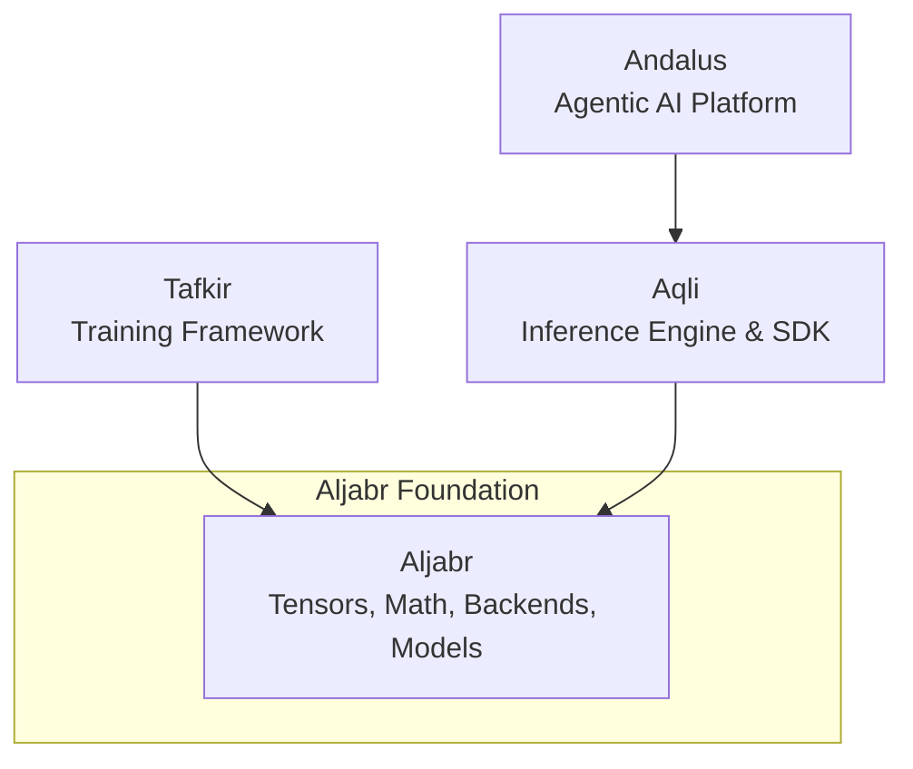

# Aljabr

<!-- Project status badges -->
[](https://github.com/andalus-ai/aljabr/actions/workflows/ci.yml)
[](https://github.com/andalus-ai/aljabr/releases)
[](LICENSE.md)
[](https://openjdk.org/projects/jdk/25/)
[](https://github.com/andalus-ai/aljabr/packages)
[](https://github.com/andalus-ai/aljabr/issues)


## "Modern AI Technology start from zero"

**Aljabr** is the foundational tensor, compute, and modeling infrastructure in Java. 

If you are coming from the Python AI ecosystem, you can think of Aljabr as **the Java equivalent of PyTorch**, combined with the foundational model configuration aspects of **Hugging Face Transformers**.

It is strictly an infrastructure and primitive layer. It does not generate text, nor does it run training loops. Instead, it provides the highly optimized, hardware-accelerated building blocks that higher-level frameworks use to accomplish those tasks.

## 🎯 Ecosystem Positioning

To understand Aljabr, it helps to see where it sits in the broader Kayys AI architecture:

```mermaid
%% Generated by https://gitdiagram.com/bhangun/aljabr
flowchart TD

subgraph group_model["Model topology"]
  node_families["Model families"]
  node_modelspi["Model SPI<br/>[ModelConfig.java]"]
  node_nn["NN primitives<br/>[NNModule.java]"]
end

subgraph group_weights["Weights and formats"]
  node_safetensor["SafeTensor loading"]
  node_safetensorspi["SafeTensor engine SPI"]
  node_quant["Weight quantization"]
  node_ggufload["GGUF loading<br/>[GGUFLoader.java]"]
  node_ggufconvert["GGUF conversion<br/>[GGUFConverter.java]"]
  node_storage["Model storage SPI"]
end

subgraph group_compute["Tensor compute"]
  node_tensor["Tensor API<br/>[Tensor.java]"]
  node_backendspi["Compute backend SPI"]
  node_memory["Inference memory"]
end

subgraph group_hardware["Hardware backends"]
  node_cpu["CPU backend<br/>[CpuBackend.java]"]
  node_cuda["CUDA backend<br/>[CUDABackend.java]"]
  node_metal["Metal backend"]
  node_rocm["ROCm backend"]
  node_blackwell["Blackwell backend"]
end

subgraph group_extensions["Supporting capabilities"]
  node_autograd["Autograd"]
  node_rag["RAG API<br/>[RagPipeline.java]"]
  node_sd["Diffusion pipeline"]
  node_whisper["Speech pipeline"]
end

node_engine(("Downstream engine"))

node_engine -->|"uses contracts"| node_modelspi
node_engine -->|"uses topology"| node_families
node_families -->|"implements SPI"| node_modelspi
node_engine -->|"loads models"| node_safetensorspi
node_safetensorspi -.->|"loads weights"| node_safetensor
node_engine -.->|"loads GGUF"| node_ggufload
node_engine -.->|"stores artifacts"| node_storage
node_engine -.->|"quantizes weights"| node_quant
node_engine -->|"executes topology"| node_nn
node_nn -->|"operates on"| node_tensor
node_tensor -->|"dispatches compute"| node_backendspi
node_engine -.->|"uses memory"| node_memory
node_backendspi -->|"implemented by"| node_cpu
node_backendspi -->|"implemented by"| node_cuda
node_backendspi -->|"implemented by"| node_metal
node_backendspi -->|"implemented by"| node_rocm
node_backendspi -.->|"implemented by"| node_blackwell
node_ggufconvert -.->|"produces format"| node_ggufload
node_engine -->|"uses gradients"| node_autograd
node_engine -.->|"uses RAG API"| node_rag
node_engine -.->|"uses model pipeline"| node_sd
node_engine -.->|"uses speech pipeline"| node_whisper

click node_families "https://github.com/bhangun/aljabr/tree/main/models"
click node_modelspi "https://github.com/bhangun/aljabr/blob/main/core/aljabr-spi-model/src/main/java/tech/kayys/aljabr/spi/model/ModelConfig.java"
click node_nn "https://github.com/bhangun/aljabr/blob/main/core/aljabr-nn/src/main/java/tech/kayys/aljabr/core/nn/NNModule.java"
click node_tensor "https://github.com/bhangun/aljabr/blob/main/core/aljabr-tensor/src/main/java/tech/kayys/aljabr/core/tensor/Tensor.java"
click node_backendspi "https://github.com/bhangun/aljabr/blob/main/core/aljabr-tensor/src/main/java/tech/kayys/aljabr/core/backend/ComputeBackend.java"
click node_memory "https://github.com/bhangun/aljabr/blob/main/core/aljabr-tensor/src/main/java/tech/kayys/aljabr/core/memory/InferenceSession.java"
click node_safetensor "https://github.com/bhangun/aljabr/tree/main/core/aljabr-safetensor-loader"
click node_safetensorspi "https://github.com/bhangun/aljabr/blob/main/core/aljabr-safetensor-spi/src/main/java/tech/kayys/aljabr/safetensor/spi/SafetensorEngine.java"
click node_quant "https://github.com/bhangun/aljabr/blob/main/core/aljabr-safetensor-quantization/src/main/java/tech/kayys/aljabr/safetensor/quantization/QuantizationEngine.java"
click node_ggufload "https://github.com/bhangun/aljabr/blob/main/core/aljabr-gguf-core/src/main/java/tech/kayys/aljabr/gguf/loader/GGUFLoader.java"
click node_ggufconvert "https://github.com/bhangun/aljabr/blob/main/core/aljabr-gguf-converter/src/main/java/tech/kayys/aljabr/converter/GGUFConverter.java"
click node_storage "https://github.com/bhangun/aljabr/blob/main/core/aljabr-spi-model/src/main/java/tech/kayys/aljabr/spi/model/ModelStorageService.java"
click node_cpu "https://github.com/bhangun/aljabr/blob/main/backend/cpu/aljabr-backend-cpu/src/main/java/tech/kayys/aljabr/backend/cpu/CpuBackend.java"
click node_cuda "https://github.com/bhangun/aljabr/blob/main/backend/cuda/aljabr-backend-cuda/src/main/java/tech/kayys/aljabr/backend/cuda/CUDABackend.java"
click node_metal "https://github.com/bhangun/aljabr/blob/main/backend/metal/aljabr-backend-metal/src/main/java/tech/kayys/aljabr/backend/metal/MetalComputeBackend.java"
click node_rocm "https://github.com/bhangun/aljabr/blob/main/backend/rocm/aljabr-kernel-rocm/src/main/java/tech/kayys/aljabr/rocm/binding/RocmHipBinding.java"
click node_blackwell "https://github.com/bhangun/aljabr/blob/main/backend/blackwell/aljabr-kernel-blackwell/src/main/java/tech/kayys/aljabr/blackwell/binding/BlackwellBinding.java"
click node_autograd "https://github.com/bhangun/aljabr/blob/main/core/autograd/src/main/java/tech/kayys/aljabr/autograd/AutogradEngine.java"
click node_rag "https://github.com/bhangun/aljabr/blob/main/core/aljabr-safetensor-api/src/main/java/tech/kayys/aljabr/safetensor/api/RagPipeline.java"
click node_sd "https://github.com/bhangun/aljabr/blob/main/models/aljabr-model-common/src/main/java/tech/kayys/aljabr/models/StableDiffusionPipeline.java"
click node_whisper "https://github.com/bhangun/aljabr/blob/main/models/aljabr-model-common/broken_models/WhisperPipeline.java"

classDef toneNeutral fill:#f8fafc,stroke:#334155,stroke-width:1.5px,color:#0f172a
classDef toneBlue fill:#dbeafe,stroke:#2563eb,stroke-width:1.5px,color:#172554
classDef toneAmber fill:#fef3c7,stroke:#d97706,stroke-width:1.5px,color:#78350f
classDef toneMint fill:#dcfce7,stroke:#16a34a,stroke-width:1.5px,color:#14532d
classDef toneRose fill:#ffe4e6,stroke:#e11d48,stroke-width:1.5px,color:#881337
classDef toneIndigo fill:#e0e7ff,stroke:#4f46e5,stroke-width:1.5px,color:#312e81
classDef toneTeal fill:#ccfbf1,stroke:#0f766e,stroke-width:1.5px,color:#134e4a
class node_families,node_modelspi,node_nn toneBlue
class node_safetensor,node_safetensorspi,node_quant,node_ggufload,node_ggufconvert,node_storage toneAmber
class node_tensor,node_backendspi,node_memory toneMint
class node_cpu,node_cuda,node_metal,node_rocm,node_blackwell toneRose
class node_autograd,node_rag,node_sd,node_whisper,node_engine toneIndigo
```






## Aljabr for research, development, and education

Aljabr is a **Java-first tensor and machine-learning framework inspired by the developer experience of PyTorch**. It aims to make tensor programming, neural-network building blocks, hardware experimentation, and model-system research accessible to Java developers without requiring Python or LibTorch in the core runtime.

Use Aljabr to:

- **Research:** prototype tensor operations, numerical methods, model architectures, and backend kernels.
- **Develop:** build reusable Java ML components and applications with explicit APIs and modular backends.
- **Teach and learn:** explore tensors, matrix operations, neural-network primitives, memory layouts, and accelerator execution in a familiar JVM toolchain.
- **Build and deploy:** integrate CPU and supported accelerator execution with model-loading and inference projects such as AQLI.
- **Extend:** implement new compute backends, tensor operations, model architecture adapters, and file-format integrations.

### Design goals

- Java APIs first, with JDK 25 as the default toolchain.
- Modular tensor, neural-network, model, and compute-backend contracts.
- CPU-first development and tests, with hardware-specific validation for accelerator backends.
- GGUF and SafeTensors model-weight support, with ONNX and LiteRT integration through their appropriate runtime adapters.
- FFM-based Java/native interoperability for new native integrations; no new JNI dependency by design.
- Reproducible builds, focused tests, explicit resource lifecycles, and documented capability boundaries.

**Scope note:** Aljabr is not a drop-in replacement for every PyTorch API, nor does the core alone promise a complete training stack. Autograd, optimizers, training loops, distributed training, and model-family support must be assessed by the status of their individual modules. See the module map and build profiles below for the current boundaries.

### Quick start

Requirements: JDK 25 and Git.

```bash
git clone https://github.com/andalus-ai/aljabr.git
cd aljabr
./gradlew test
```

Start with the tensor and neural-network modules for learning and experiments. Add backend- or model-specific modules only when needed, and validate native acceleration on the target operating system and hardware.

### Maven packages

Tagged releases can be published to GitHub Packages as Maven artifacts. For a private or organization-scoped package, configure GitHub Packages credentials in your Gradle user-level `gradle.properties` (never commit tokens):

```properties
gpr.user=YOUR_GITHUB_USERNAME
gpr.key=YOUR_GITHUB_TOKEN
```

Consumer repository configuration:

```kotlin
repositories {
    maven {
        url = uri("https://maven.pkg.github.com/andalus-ai/aljabr")
        credentials {
            username = providers.gradleProperty("gpr.user").orNull
            password = providers.gradleProperty("gpr.key").orNull
        }
    }
}
```

Artifact coordinates depend on the published module. The default group is `tech.kayys.aljabr`; use the specific module artifact ID and release version shown in the GitHub Packages page. GitHub Packages authentication and package visibility follow GitHub's repository and organization settings.

## Build profiles

Aljabr's foundational build is intentionally independent of Tafkir. A checkout of Tafkir
must not be required just to compile or test Aljabr's core tensor, model SPI, and backend
modules.

- **Default / core build:** `./gradlew test`
- **Tafkir source integration:** `./gradlew -PwithTafkir=true test`

The `withTafkir` profile includes the sibling `../tafkir` composite build and enables
the Aljabr SafeTensors quantization adapter that consumes Tafkir quantizer artifacts.
Use it when validating the cross-project integration, not as a prerequisite for ordinary
core development. The integration profile requires a sibling Tafkir checkout with Gradle
settings; it does not guarantee that Tafkir itself is currently buildable.

### The Separation of Concerns
1. **Aljabr (Foundation)**: Knows how to multiply matrices, allocate memory on a GPU, parse SafeTensors, and define what a "Gemma" model looks like.
2. **Tafkir (Training)**: Knows how to calculate loss, apply gradients, run optimizers, and execute training loops. Depends on Aljabr for math and autograd.
3. **Aqli (Inference)**: Knows how to sample tokens, handle continuous batching, and route requests. Depends on Aljabr for fast forward passes and KV caching.
4. **Andalus (Application)**: Knows how to orchestrate multi-agent reasoning and RAG workflows. Depends on Aljabr for text generation.

By isolating the heavy infrastructure into Aljabr, both Tafkir and Aljabr can share the exact same hardware backends and memory models without dragging each other's specific dependencies around.

## Architecture and ecosystem boundaries

The target framework responsibilities, tensor/model execution sequences, native integration rules and cross-project boundaries are documented in the [Aljabr Framework Architecture](docs/architecture/FRAMEWORK_ARCHITECTURE.md). For the serving/runtime side, see the [AQLI System Architecture](https://github.com/andalus-ai/aqli/blob/main/docs/architecture/SYSTEM_ARCHITECTURE.md), [AQLI Sequence Flows](https://github.com/andalus-ai/aqli/blob/main/docs/architecture/SEQUENCE_FLOWS.md), and [Aljabr–AQLI Consolidation Roadmap](https://github.com/andalus-ai/aqli/blob/main/docs/architecture/ALJABR_AQLI_CONSOLIDATION_ROADMAP.md).

Aljabr provides reusable computation and model execution; AQLI owns serving policy, request scheduling and operational lifecycle; Tafkir owns optional training workflows. These are target ownership rules and should not be interpreted as proof that all migrations are complete.

## 🏗️ Core Architecture & Modules

Aljabr is designed with a strict modular structure to maintain a clear Separation of Concerns:

* `core/`: The heart of Aljabr.
  * `aljabr-tensor`: N-dimensional arrays, precision types (FP32, FP16, BF16, INT8).
  * `aljabr-nn`: Neural network primitives and activation functions (GELU, SiLU).
  * `autograd`: Automatic differentiation for training (`tafkir` uses this).
  * `aljabr-safetensor-*` / `aljabr-gguf-*`: High-performance weight loaders.
  * `aljabr-spi-model`: The foundational contract defining `ModelConfig`, `ModelArchitecture`, and `ModelRuntimeTraits`.
* `backend/`: Hardware-accelerated execution routes.
  * `cpu`, `metal` (Apple Silicon MPS), `cuda` (NVIDIA GPUs), `rocm` (AMD).
  * Each backend provides optimized kernels for the tensor operations defined in `core`.
* `models/`: Implementations of the `aljabr-spi-model` contract for hundreds of specific model architectures (Gemma, Llama, Qwen, BERT, etc.). These provide the topology but NOT the inference logic.

## 🧑‍💻 Developer Guidance

When contributing to Aljabr or any downstream framework (`aljabr` / `tafkir`), strictly adhere to the following principles:

### 1. Capabilities over Identities
**Never** write code that checks the identity of a model (e.g., `if (modelType.equals("gemma3"))`). This breaks extensibility.
Instead, check for operational capabilities (e.g., `if (traits.requiresTurnAwarePromptBos())`). If a new model needs a specific behavior, add a generic capability flag to `ModelRuntimeTraits` in `aljabr-spi-model` and map the model to it.

### 2. Strict Separation of Concerns
* **Aljabr** handles math, tensors, and static topology. It should never contain code related to continuous batching, sampling temperature, or KV cache orchestration.
* **Aljabr** handles the stateful, dynamic process of inference. It uses Aljabr's math and topology to execute the forward pass.
* **Tafkir** handles the stateful process of training. It uses Aljabr's autograd and math to execute the backward pass.

### 3. Adding New Models
To add a new model family, you do not need to touch the inference or training engines. 
Simply add a new module under `aljabr/models/` that implements the `ModelArchitecture` SPI. Specify its precise structural traits (e.g., uses SwiGLU, has parallel attention) so that the engines know how to process it dynamically.


## 📝 License

Aljabr is licensed under the [MIT License](LICENSE.md).
