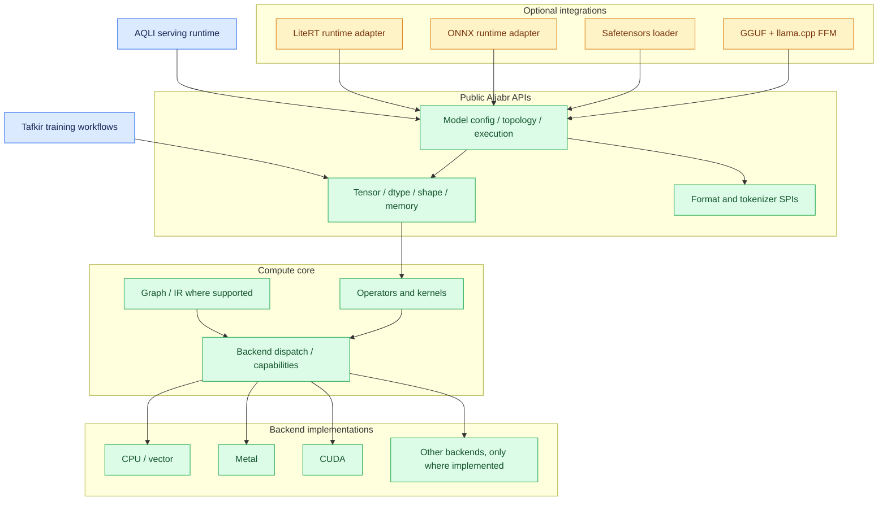
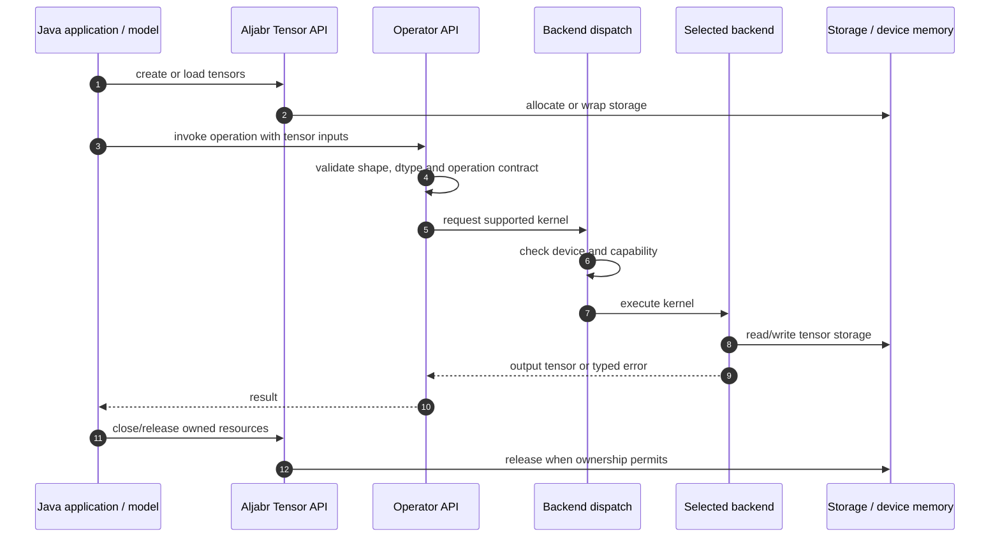
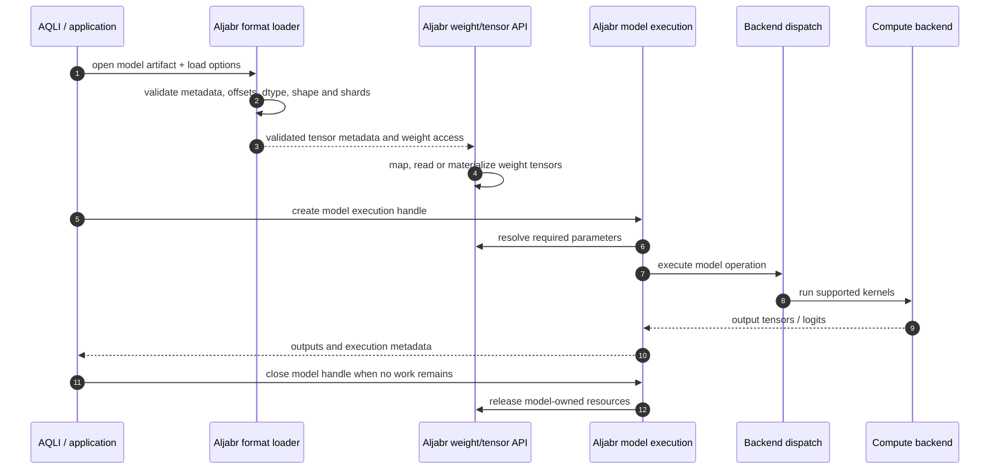
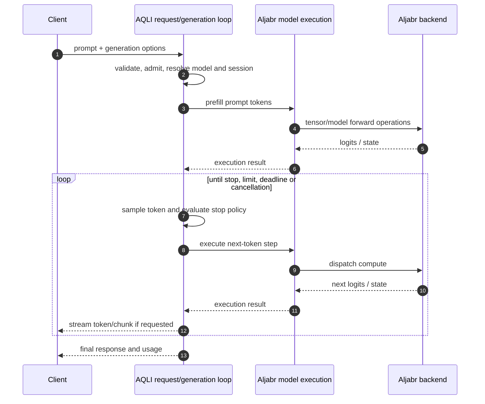

# Aljabr Framework Architecture

**Baseline:** 2026-10-28  
**Java baseline:** JDK 25  
**Status:** Framework target architecture. Module capability and implementation status must be verified in source and CI; the target diagrams are not a claim that every backend or format is complete.

## 1. Mission and scope

Aljabr is a reusable Java ML engine/framework for research, development, education and application building. It provides reusable primitives and execution APIs that higher-level applications and runtimes can compose.

Aljabr is not required to be an HTTP server, CLI product or deployment control plane. It can execute tensor and model operations directly, including the model-forward operations needed by inference, without owning a serving product's request policy.

**Core principle:** Aljabr owns reusable computation and model execution; AQLI owns inference serving and operational policy; Tafkir owns training workflow orchestration.

## 2. Responsibility boundaries

### Aljabr owns

- Tensor abstractions: shape, dtype, layout, storage, views, device placement and resource lifetime.
- Operators, numerical kernels, compute dispatch and backend contracts.
- Neural-network building blocks, model topology/configuration and reusable model-family execution.
- Reusable model-weight and format APIs for GGUF and Safetensors.
- Optional ONNX/LiteRT runtime integrations, with graph execution capability clearly distinguished from format inspection.
- Tokenizer contracts and reusable tokenizer algorithms.
- Low-level FFM declarations and native integration APIs where required.
- Reusable execution primitives that can be called by an application, AQLI or Tafkir.

### Aljabr does not own

- Request admission, queueing, continuous batching policy, per-tenant quotas or service-level scheduling.
- HTTP/OpenAI-compatible/gRPC endpoints, authentication filters, server health/admin endpoints or CLI lifecycle.
- Serving-level token streaming, client disconnect policy, request cancellation policy and service metrics aggregation.
- Training orchestration, dataset pipelines, optimizer loops and fine-tuning workflow policy owned by Tafkir.
- Agent orchestration, tools, enterprise workflow and application-level RAG coordination.

AQLI may call Aljabr's model-execution APIs repeatedly to implement prefill and decode. This does not move serving policy into Aljabr. Tafkir may use Aljabr's tensor, autograd and backend APIs to implement training.

## 3. Layered architecture

This diagram describes conceptual responsibilities, not exact Gradle module dependencies. The module ownership matrix in the AQLI consolidation documentation records cross-repository migration candidates.

## 4. Tensor operation sequence

### Tensor and memory contract

Every public operation should document:
- Shape, dtype, layout and numerical semantics.
- Whether output storage aliases input storage or allocates a new buffer.
- Device placement and whether implicit copies can occur.
- Thread-safety and concurrent access behavior.
- Ownership, borrowing, close semantics and native/device lifetime.
- Error behavior for unsupported dtype, shape, device or kernel.

Avoid hidden CPU/GPU copies in performance-sensitive paths unless documented and observable. A backend must not access a closed segment or free device memory while an operation is still using it.

## 5. Model loading and execution sequence

Format parsing, tensor materialization and model execution are separate contracts. A successful parse does not imply that the model's operators, quantization, dtype or selected backend are supported. Fail early with a diagnostic capability error rather than failing later with a low-level index or native symbol error.

## 6. Inference and training integration

### Inference through AQLI

AQLI owns the request lifecycle and generation policy. Aljabr provides reusable model-forward computation and backend execution. AQLI may own sampling, stopping criteria, streaming, admission, session policy, cancellation propagation and request metrics.

### Training through Tafkir

Tafkir owns dataset orchestration, loss/optimizer/training loops and adaptation workflows. It consumes Aljabr's tensor/autograd/backend APIs. Aljabr must not require Tafkir to build its foundational modules, and AQLI's default inference dependency graph must not pull training-only artifacts.

## 7. Model format and native interoperability policy

- **GGUF:** Aljabr owns reusable metadata/tensor parsing and low-level llama.cpp/ggml FFM declarations. Native execution remains capability-gated by platform and ABI.
- **Safetensors:** Aljabr owns header/offset/dtype/shape validation and reusable weight loading. AQLI's model-forward/decode path is migrated only when execution parity is proven.
- **ONNX/LiteRT:** format inspection, graph loading and runtime execution are separate capabilities. Runtime libraries and unsupported operators must be reported explicitly.
- **FFM:** generated ABI declarations, layouts, native handles and memory-scope rules have one canonical owner. Avoid new JNI dependencies by design; validate the target JDK and native platform.
- **Optional native libraries:** a missing library should not make unrelated CPU-only core APIs unusable. Provider discovery must return an actionable error and avoid unsafe fallback.

## 8. Model capabilities, not model-name conditionals

Model-specific execution differences should be represented through model metadata, topology and explicit runtime traits/capabilities where feasible. Avoid scattered string checks such as comparing a model name to decide a low-level behavior. Capability declarations should express the actual requirement, be tested, and fail explicitly when unsupported.

Examples of capability dimensions:
- Attention variants and KV layout requirements.
- Positional encoding and prompt/special-token behavior.
- Supported dtypes and quantization formats.
- Required operators and backend features.
- Context limits, state persistence and batch support.
- Native runtime/platform requirements.

## 9. Module placement rules

- Core tensor and compute APIs must not depend on AQLI, Tafkir or server frameworks.
- Format modules depend inward on tensor/SPI APIs; tensor core must not depend back on format-specific loaders.
- Optional quantization integrations must not create a parser/loader/core dependency cycle.
- Model-family modules depend on public model/tensor contracts, not on AQLI request types.
- Native generated declarations have one canonical module and package.
- HTTP resources, serving routes and deployment configuration belong in AQLI unless they are demonstrably generic non-server APIs.
- Use public, published module coordinates in downstream projects and verify clean consumer resolution.

## 10. Validation strategy

| Layer | Required checks |
|---|---|
| Tensor and operators | Shape/dtype errors, numerical tolerances, aliasing and resource lifetime |
| Backend | Capability checks, supported-device tests, fallback policy and concurrent execution |
| Format loaders | Truncated/malformed files, bounds, shards, dtype/shape consistency and cleanup |
| Model execution | Golden forward outputs, model-family fixtures, cache/state correctness |
| FFM/native | ABI layouts, symbol lookup, JDK compatibility, memory scope and native cleanup |
| Optional integration | Default core build without optional dependency; explicit missing-provider error |
| Cross-project | Composite build and published-artifact resolution |
| Performance | Same model, prompt, hardware, warm-up, token limit and end-to-end metrics |

## 11. Related architecture documents

- [AQLI System Architecture](https://github.com/andalus-ai/aqli/blob/main/docs/architecture/SYSTEM_ARCHITECTURE.md)
- [AQLI Sequence Flows](https://github.com/andalus-ai/aqli/blob/main/docs/architecture/SEQUENCE_FLOWS.md)
- [AQLI Module Ownership Matrix](https://github.com/andalus-ai/aqli/blob/main/docs/architecture/MODULE_OWNERSHIP_MATRIX.md)
- [Aljabr–AQLI Consolidation Roadmap](https://github.com/andalus-ai/aqli/blob/main/docs/architecture/ALJABR_AQLI_CONSOLIDATION_ROADMAP.md)

## 12. Status and change control

This document states the target boundary. Mark each capability as planned, in progress, blocked or verified in implementation-specific tracking. Do not claim that a backend, model family, format or optimization is supported based only on a class name or a diagram. Changes to public APIs, resource ownership or dependency direction should include an ADR or an equivalent decision record and focused tests.
