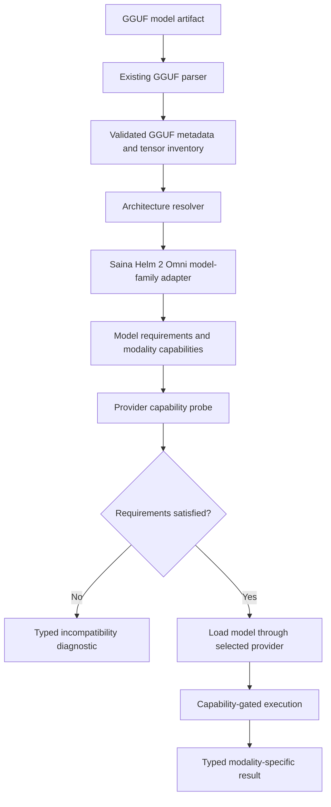

# Saina Helm 2 Omni 0.8B GGUF integration

- **Status:** Design / architecture audit; model execution is not yet verified.
- **Target model:** [run-saina/saina-helm-2-omni-0.8b-GGUF](https://huggingface.co/run-saina/saina-helm-2-omni-0.8b-GGUF)
- **Owning repository:** Aljabr
- **Consumers:** Java applications and AQLI; serving policy remains outside Aljabr.

## 1. Goal

Add support for this model without introducing a one-off inference stack. Reuse Aljabr's GGUF parser, backend SPI, tokenizer contracts, tensor/model APIs and provider discovery. Model-family behavior must be expressed as declared, inspectable capabilities and validated requirements—not model-name conditionals scattered through backends.

This document deliberately distinguishes a model catalogue entry, a successful GGUF parse, backend readiness, and validated end-to-end multimodal execution. They are different states.

## 2. Source audit: existing extension points

The current source tree already provides useful foundations:

| Existing component | Verified contract | Integration implication |
|---|---|---|
| `:engine:gguf:aljabr-gguf-api` | `GgufBackendProvider`, `GgufBackendCapability`, `GgufBackend`, `GgufBackendSelection` | Extend the existing GGUF capability path; do not create a parallel provider registry. |
| `GgufBackendProvider.probe(Path)` | Header-only readiness probe | Architecture, tensor and quantization requirements should be checked before full model load. |
| `GgufBackendCapability` | `generationReady`, architecture, quantization types, reason, diagnostics | Current readiness is generation-oriented and does not yet express modality-specific input/output support. |
| `GgufBackend` | Text `InferenceRequest` execution, streaming, embeddings | The current public GGUF execution contract does not establish audio or general multimodal execution. |
| `:engine:gguf:aljabr-gguf-core` | GGUF metadata and tensor parsing | Reuse parsing; do not duplicate the GGUF reader in a model-family module. |
| `:models:aljabr-model-gemma4` | Independently installable model-family module pattern | Keep model-family metadata and adapters outside the GGUF parser/core. |
| `:spi:aljabr-spi-model` and `:spi:aljabr-spi-tokenizer` | Existing model/tokenizer extension points | Reconcile with these public contracts before adding another model API. |

## 3. Required architecture

Keep responsibilities in these layers:

1. **GGUF format layer** — parses metadata, tensor descriptors, offsets and quantization identifiers. It remains model-family agnostic.
2. **Model-family adapter** — identifies the actual architecture from GGUF metadata and defines required tensor names, shapes, operators, preprocessing and postprocessing.
3. **Capability contract** — describes what a model requires and what a provider can execute. It must distinguish input modalities from output modalities and distinguish declared support from validated support.
4. **Execution provider** — implements operations behind Aljabr APIs. llama.cpp/ggml or another runtime remains an optional provider, never a public model API dependency.
5. **Consumer/runtime** — AQLI or an application owns model selection policy, request scheduling, serving lifecycle, streaming policy and operational metrics.

### Capability dimensions

The model adapter should declare the following only when verified from the model card, GGUF metadata and implementation:

- Input modalities: text, image, audio, video, or other structured input.
- Output modalities: text, audio, image, or structured output.
- Tasks: text generation, transcription, speech understanding, speech generation, audio-to-audio, or other explicitly supported tasks.
- Processing requirements: tokenizer, chat template, audio feature extraction, resampling, image preprocessing, modality markers, and output decoding.
- Architecture requirements: attention variant, positional encoding, state/cache layout, tensor naming, required operators and supported tensor/quantization types.
- Execution constraints: context/window limits, maximum audio duration, sample rate, batch constraints, supported devices and provider requirements.

A model capability declaration is not evidence that a provider implements it. The registry/readiness result must retain distinct declared, installed, available, compatible and validated states.

## 4. Proposed capability flow

The resolver must not fall back to a generic text model path when an unknown architecture or unsupported modality is encountered. It should return an actionable unsupported-architecture or unsupported-capability diagnostic.

## 5. Implementation sequence and gates

### M1 — Model artifact and architecture verification

Obtain and record:
- Model card and upstream architecture/configuration.
- GGUF metadata keys and values, including `general.architecture`, tokenizer metadata, tensor inventory and quantization types.
- All available GGUF variants/shards and their intended usage.
- Tokenizer/chat template and any modality-specific preprocessing assets.
- Upstream runtime compatibility evidence and licensing notes.

**Gate:** no architecture identifier, tensor mapping, modality list, or context limit is hard-coded from the repository name alone.

### M2 — Reusable capability contract

- Audit the existing model SPI and GGUF capability API for compatible extension points.
- Add modality/task descriptors to the canonical capability contract, with stable identifiers and versioning.
- Represent model requirements separately from provider-supported capabilities.
- Preserve backward compatibility for existing text-only providers.
- Add conformance tests for capability matching, unsupported modalities, missing preprocessing assets and diagnostic reasons.

**Gate:** existing GGUF providers compile unchanged or receive a documented migration path; capability matching has independent tests.

### M3 — Reusable modality processing

Implement reusable processors only for modalities verified for this model:
- Audio: sample-rate/channel validation, framing, feature extraction or codec handling, timestamps/chunk boundaries, and output decoding as applicable.
- Image/video: image normalization, patch/frame extraction and ordering as applicable.
- Text: tokenizer, special-token and chat-template handling.

Do not put reusable audio/image preprocessing in a Saina-specific package if it can serve other models. Keep model-specific adapters limited to architecture-specific configuration and composition.

**Gate:** deterministic fixtures cover valid, malformed, empty, boundary and unsupported inputs; resource ownership is tested.

### M4 — Model-family adapter and provider execution

- Add the model-family module following existing Aljabr module conventions.
- Resolve the model by verified architecture metadata, not a model-name string.
- Probe provider compatibility before loading tensor data.
- Implement only the model operations supported by the selected provider.
- Keep native runtime dependencies optional and isolated.
- Expose typed output structures rather than overloading plain text strings for non-text results.

**Gate:** an actual model fixture runs end-to-end with an independently checked expected result on a documented provider/platform.

### M5 — Consumer integration and release

- Provide a Java example that discovers capabilities, checks provider readiness and executes a supported task.
- Document optional Gradle dependencies and native runtime prerequisites.
- Verify a clean consumer build without optional GGUF/native dependencies unless explicitly selected.
- Publish provider/model support matrices with exact validation scope.

**Gate:** CI, model-fixture tests, dependency graph checks and a reproducible runtime smoke test pass.

## 6. Acceptance criteria

- No model-name conditionals in generic GGUF parser/provider code.
- Model-family code depends on stable Aljabr APIs, never on AQLI serving types.
- Existing text-only GGUF execution remains source/binary compatible where promised.
- A provider cannot claim audio/image/video support solely by returning `generationReady=true`.
- Unsupported tasks fail before execution with a diagnostic naming the missing capability.
- Model load and unload release file, native-memory and processor resources deterministically.
- No fabricated modality support, benchmark, or validation claim.
- Optional GGUF/native dependencies do not leak into unrelated Aljabr consumers.

## 7. Current blocker

The repository audit confirms that the existing GGUF API has a generation readiness flag and a text-oriented request/response execution contract. It does not prove that this model's audio or other Omni pathways can be represented or executed today.

The Hugging Face model card and the model's actual GGUF metadata/tensor inventory were not available to this implementation environment during this change. Therefore this change does **not** claim Saina Helm 2 Omni execution support and intentionally does not guess its architecture identifier, tokenizer, audio frontend, tensor map, or supported tasks.

The next implementation change must start from the upstream model card and a real GGUF metadata dump. This is a correctness gate, not a reason to create a model-specific placeholder implementation.

## 8. M2 implementation progress

The first reusable capability-contract slice is now implemented in
`:engine:gguf:aljabr-gguf-api`:

- `GgufModality` and `GgufTask` provide model-family-neutral identifiers.
- `GgufCapabilitySet` describes input modalities, output modalities and tasks.
- `GgufCapabilityMatcher` compares a model/task requirement with a provider's
  independently declared capabilities.
- `GgufCapabilityMatch` reports missing input, output and task capabilities
  separately, so callers can produce actionable diagnostics.
- Unit tests cover successful matching, modality/task mismatches, empty
  requirements, defensive immutability and invalid null profiles.

This is deliberately additive. The existing `GgufBackendCapability` record,
provider SPI and text execution methods are unchanged, so current providers
continue to compile without a migration. The new contract is not yet wired into
provider selection or execution; that integration requires a follow-up change
that preserves the existing AUTO-selection behavior and introduces explicit
task requirements. No Saina-specific capability profile is declared until the
upstream artifact is verified.

## 9. M3 provider-selection integration

A follow-up implementation now connects the reusable capability profile to
GGUF provider selection:

- `GgufBackendCapability` carries a `GgufCapabilitySet` returned by the
  provider's existing cheap probe.
- The original five-argument constructor and existing `ready(...)` factory
  remain source-compatible. Legacy ready providers conservatively advertise
  text generation only; providers must opt in explicitly to additional tasks.
- `GgufInferenceEngine.loadModel(..., requiredCapabilities)` adds an opt-in
  capability-aware loading path. The original overload preserves existing
  behavior.
- AUTO selection skips generation-ready providers that do not satisfy the
  requested modalities/tasks, then continues to lower-priority providers.
- Explicit provider selection retains its deliberate probe bypass when no
  requirements are supplied. When requirements are supplied, it probes and
  rejects incompatible or unverifiable providers before backend creation.
- Decision-observer events distinguish capability rejection, probe failure
  and successful selection.

The model requirement is passed explicitly as a typed `GgufCapabilitySet`;
the engine does not infer unsupported modalities from a model name or metadata
heuristic. A Saina-specific profile remains gated on verified upstream model
metadata and a real GGUF artifact.

## 10. M2 artifact-inspection contract

The inference-facing GGUF API now includes `GgufModelDescriptor`, an immutable
metadata-only view that can be constructed from the existing parser's metadata
map and tensor-name inventory:

- Captures `general.architecture` and `general.name` only when their values
  are strings.
- Retains deterministic, immutable metadata-key and tensor-name sets.
- Reports whether known tokenizer metadata keys and a nonblank
  `tokenizer.chat_template` are present.
- Provides tensor-prefix inspection for model-family adapters and a concise
  artifact summary.

This descriptor intentionally does **not** infer modality/task support from
architecture names, tensor-name fragments, tokenizer presence or chat-template
presence. A family adapter must validate its expected tensor shapes and
required processing assets, and a provider must independently establish
execution support before declaring capabilities. The descriptor is evidence
collection, not a model-family adapter or a substitute for a real-artifact
compatibility test.
